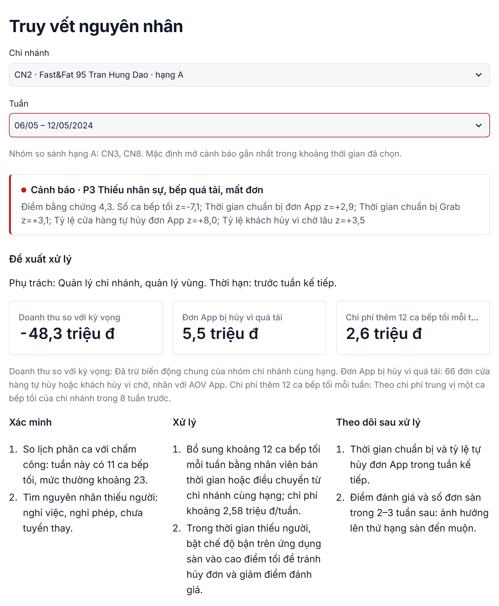
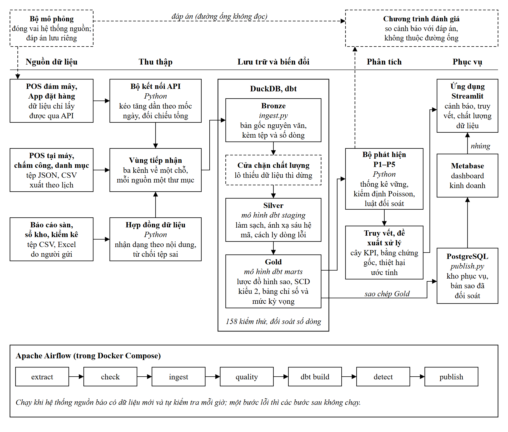
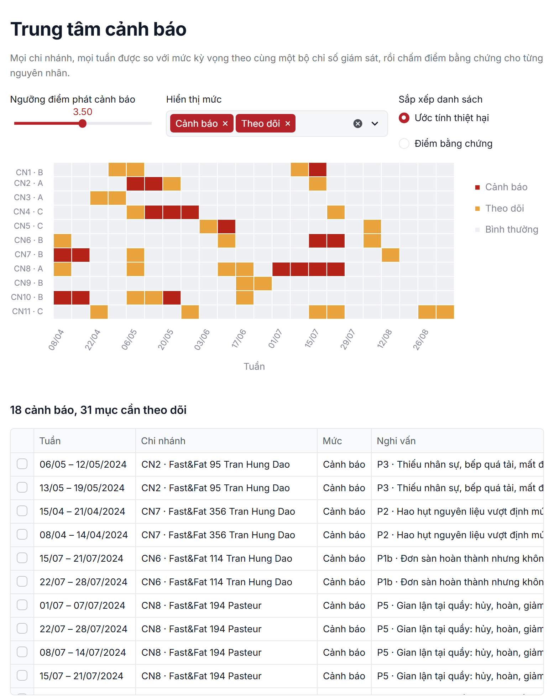
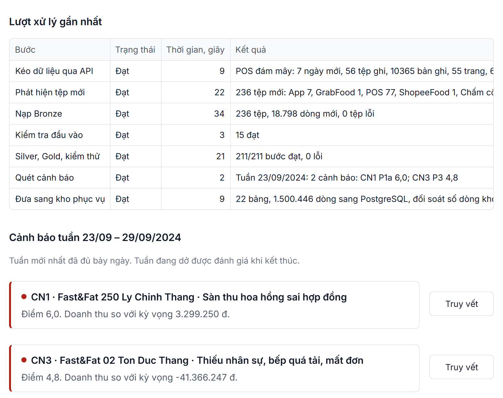
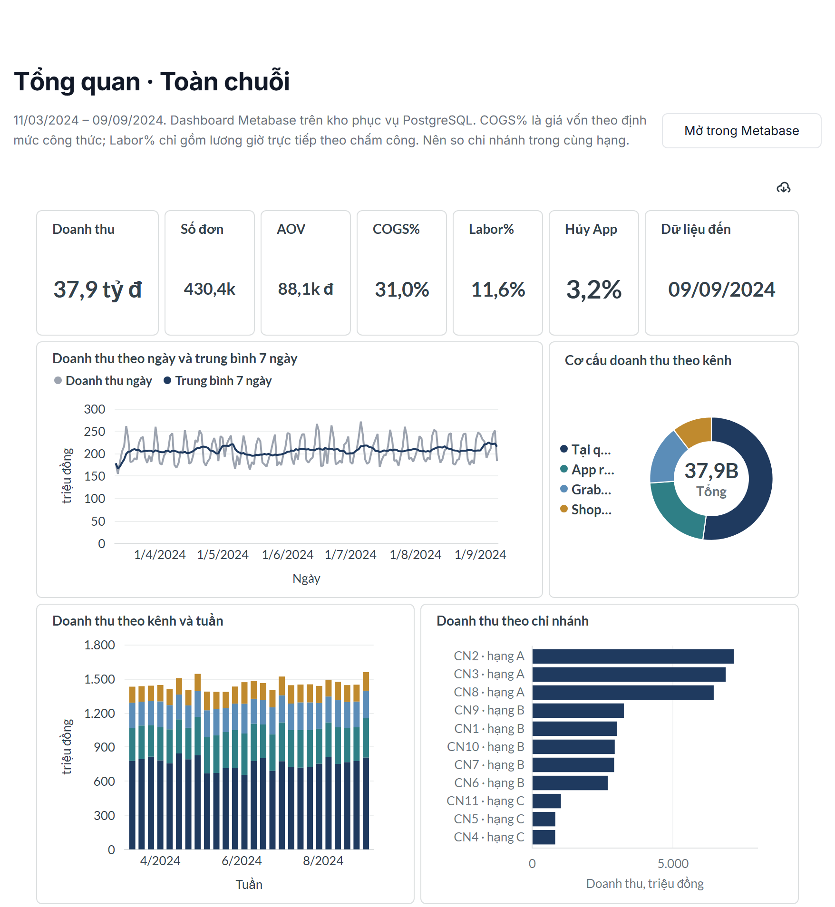
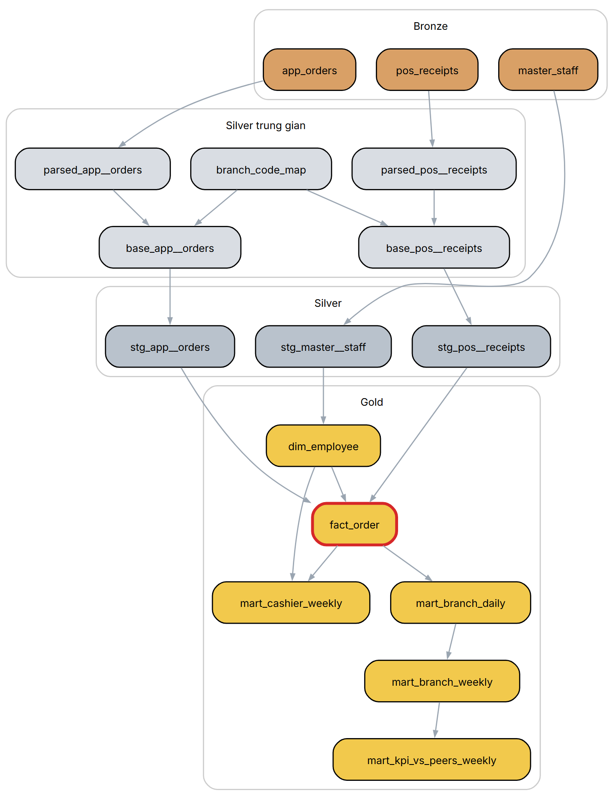
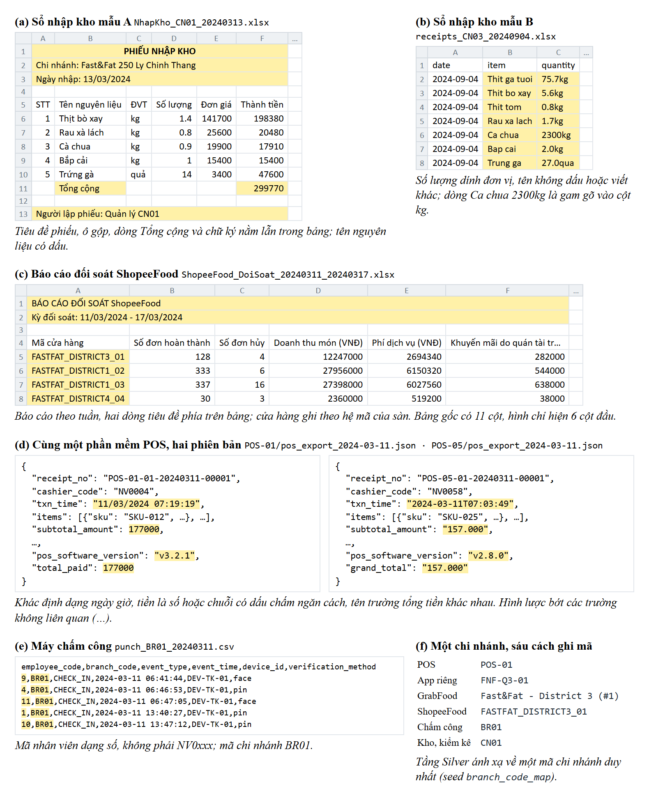
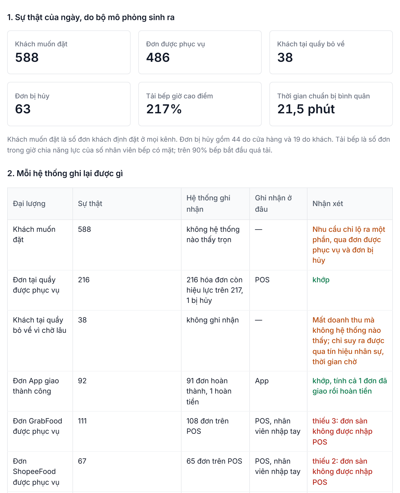

# F&B Ops Data Platform

Nền tảng tích hợp và phân tích dữ liệu vận hành đa nguồn, hỗ trợ truy vết nguyên nhân biến động doanh thu cho chuỗi F&B.

Khóa luận tốt nghiệp ngành Công nghệ thông tin, Trường Công nghệ và Thiết kế, Đại học Kinh tế TP. Hồ Chí Minh.
Sinh viên thực hiện: Lê Cao Phúc. Giảng viên hướng dẫn: TS. Ngô Tấn Vũ Khanh.

[Trang giới thiệu](https://phuclc17.github.io/fnb-ops-data-platform/) ·
[Ứng dụng trực tuyến](https://phuclc17.github.io/fnb-ops-data-platform/app/) ·
[Video trình diễn](https://phuclc17.github.io/fnb-ops-data-platform/#video) ·
[Báo cáo PDF](docs/BaoCao_KhoaLuan.pdf) ·
[Tài liệu dbt](https://phuclc17.github.io/fnb-ops-data-platform/dbt/)

Ứng dụng trực tuyến mở được ngay trên trình duyệt, không cần cài đặt. Nếu trang đang khởi động, chờ khoảng một đến hai phút.



## Bài toán

Một chuỗi đồ ăn nhanh 11 chi nhánh bán tại quầy, qua ứng dụng riêng, GrabFood và ShopeeFood. Dữ liệu vận hành nằm ở bảy hệ thống, mỗi hệ thống một định dạng, một bộ mã và kiểu lỗi nhập liệu riêng. Khi doanh thu hay lợi nhuận giảm, quản lý chỉ thấy con số tổng.

Nền tảng đưa dữ liệu của bảy hệ thống về một kho, rồi đối chiếu chéo để phát hiện năm loại sự cố:

| Mã | Sự cố | Dữ liệu đối chiếu |
|---|---|---|
| P1 | Sàn tính sai hoa hồng, đơn sàn không được nhập POS | Báo cáo đối soát sàn, POS, hợp đồng |
| P2 | Hao hụt nguyên liệu vượt định mức | Sổ nhập kho, phiếu kiểm kê, lượng bán theo công thức |
| P3 | Thiếu nhân sự, bếp quá tải | Chấm công, POS, ứng dụng, báo cáo sàn |
| P4 | Thất thoát hàng giá trị cao | Phiếu kiểm kê, sổ nhập kho, lượng bán |
| P5 | Gian lận tại quầy | Hóa đơn hủy, hoàn, giảm giá theo thu ngân |

Mỗi cảnh báo có nguyên nhân, mức thiệt hại ước tính, đề xuất xử lý và đường dẫn về đúng dòng trong tệp gốc.

Fast&Fat là chuỗi giả định. Dữ liệu vận hành của doanh nghiệp không công khai, nên một bộ mô phỏng đóng vai các hệ thống nguồn và sinh kèm hai tập sự cố có đáp án để đánh giá. Đường ống và bộ phát hiện không đọc bộ mô phỏng hay đáp án.

## Kiến trúc



| Chặng | Công nghệ | Nội dung |
|---|---|---|
| Thu thập | Python, FastAPI | Kéo API của POS đám mây và ứng dụng theo mốc ngày; nhận tệp theo hợp đồng dữ liệu |
| Bronze | DuckDB | Lưu nguyên văn kèm tệp và số dòng gốc; nạp tăng dần theo mã băm tệp |
| Silver | dbt | Hợp nhất hai phiên bản POS, giải quyết định danh giữa sáu hệ mã, cách ly dòng lỗi kèm lý do |
| Gold | dbt | Lược đồ hình sao: 6 bảng sự kiện, 7 bảng chiều, 2 chiều SCD2, 5 bảng chỉ số; 158 kiểm thử |
| Phân tích | Python | Mức kỳ vọng theo nhóm chi nhánh cùng hạng, cây KPI, năm bộ phát hiện, đề xuất xử lý |
| Phục vụ | PostgreSQL, Metabase, Streamlit | Kho phục vụ chỉ đọc, dashboard kinh doanh, ứng dụng 14 trang |
| Điều phối | Airflow, Docker Compose | Hai DAG nối bằng Dataset: dữ liệu mới về thì đường ống tự chạy |

## Giao diện

| | |
|---|---|
|  |  |
| Trung tâm cảnh báo: mọi chi nhánh, mọi tuần, sắp theo thiệt hại ước tính | Vận hành hằng ngày: một lượt đường ống với bảy ngày dữ liệu mới |
|  |  |
| Dashboard Metabase trên kho phục vụ PostgreSQL | Phả hệ của bảng fact_order, sinh từ siêu dữ liệu dbt |
|  |  |
| Dữ liệu thô của các hệ thống nguồn | Một ngày của chi nhánh: sự thật đặt cạnh những gì các hệ thống ghi lại |

## Kết quả

Ngưỡng cảnh báo được chọn trên tập phát triển rồi chạy tập kiểm tra đúng một lần.

| Tập | Sự cố phát hiện | Đúng nguyên nhân | Precision | Recall theo tuần | F1 | Độ trễ trung vị |
|---|---|---|---|---|---|---|
| Phát triển | 5/6 | 5/5 | 0,72 | 0,87 | 0,79 | 6 ngày |
| Kiểm tra | 4/6 | 3/4 | 0,50 | 0,54 | 0,52 | 6 ngày |

Trên tập kiểm tra, chỉ theo dõi doanh thu phát hiện 1/6 sự cố (F1 0,11), Isolation Forest phát hiện 2/6 (F1 0,15). Thất thoát kho với nhịp kiểm kê hai tuần không phát hiện được ở cả hai tập. Chi tiết và phân tích lỗi: [docs/results/KET_QUA_DANH_GIA.md](docs/results/KET_QUA_DANH_GIA.md).

Về dữ liệu: 211/211 bước dbt đạt trên cả ba môi trường; số dòng Bronze bằng Silver cộng cách ly cộng dòng cấu trúc ở cả bảy nguồn; doanh thu thuần ở Gold khớp Silver theo từng chi nhánh và ngày. Một lượt bảy ngày dữ liệu mới đi từ hệ thống nguồn đến cảnh báo trong khoảng 150 giây.

## Mã nguồn

| Thư mục | Nội dung |
|---|---|
| `simulator/` | Bộ mô phỏng các hệ thống nguồn và kịch bản sự cố |
| `source_api/` | API giả lập của POS đám mây và ứng dụng đặt hàng |
| `pipeline/` | Thu thập, hợp đồng dữ liệu, nạp Bronze, cửa chặn chất lượng, đưa sang kho phục vụ |
| `dbt/` | Mô hình Silver, Gold và kiểm thử dữ liệu |
| `analytics/` | Bộ phát hiện, đề xuất xử lý, đánh giá, phân tích độ nhạy |
| `app/` | Ứng dụng Streamlit |
| `airflow/`, `docker/`, `docker-compose.yml` | Điều phối và đóng gói |
| `bi/` | Dựng dashboard Metabase bằng mã |
| `deploy/` | Cấu hình chạy trên máy chủ và trên Hugging Face Spaces |
| `tests/` | 89 kiểm thử pytest |
| `docs/` | Báo cáo, kết quả đánh giá, hình |

## Chạy trên máy

<details>
<summary>Yêu cầu Python 3.12 và Docker Desktop</summary>

```bash
python -m venv .venv
.venv/Scripts/pip install -r requirements.txt        # Linux, macOS: .venv/bin/pip

# Sinh dữ liệu nguồn 182 ngày cho hai tập đánh giá, khoảng 3,5 phút mỗi tập
.venv/Scripts/python -m simulator.run --profile calibration --days 182 --reset
.venv/Scripts/python -m simulator.run --profile holdout --days 182 --reset

# Nạp Bronze, dựng Silver và Gold, chạy kiểm thử (làm tương tự với --profile holdout)
.venv/Scripts/python -m pipeline.ingest --profile calibration
.venv/Scripts/python -m pipeline.run_dbt --profile calibration build

# Đánh giá bộ phát hiện
.venv/Scripts/python -m analytics.evaluate --profile calibration

# Môi trường vận hành và toàn bộ dịch vụ
.venv/Scripts/python -m pipeline.run_daily --init-live
docker compose up -d --build
```

| Địa chỉ | Thành phần |
|---|---|
| http://localhost:8501 | Ứng dụng |
| http://localhost:8080 | Airflow (admin / admin) |
| http://localhost:3000 | Metabase |
| http://localhost:8600/docs | API nguồn giả lập |

Dashboard Metabase được dựng bằng `python -m pipeline.publish --profile <tập>` rồi `python bi/metabase_setup.py`. Mật khẩu trong `docker-compose.yml` là giá trị mặc định cho máy cá nhân.

</details>

## Giới hạn

Dữ liệu là mô phỏng, chưa kiểm chứng trên dữ liệu thật của doanh nghiệp. Một số phân phối hành vi mua hàng được hiệu chỉnh từ bộ dữ liệu giao dịch công khai The Bread Basket (OpenML 43422). Mỗi tập chỉ có sáu kịch bản sự cố nên các tỷ lệ phát hiện mang tính chỉ báo. Xem mục 6.3 của báo cáo.
